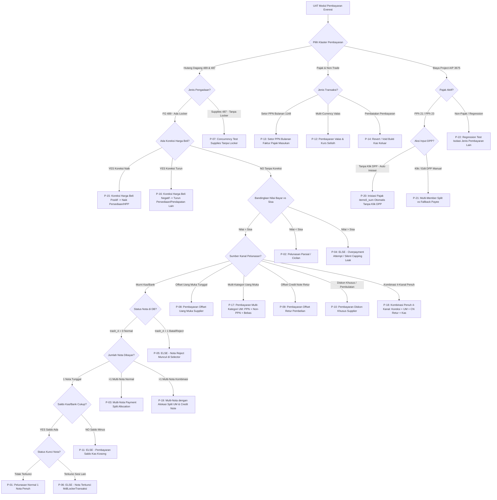

# 📑 Dokumen Spesifikasi & Rencana UAT Pipeline Berjenjang Modul Pembayaran
**Nomor Dokumen**: `UAT_PEMBAYARAN_PIPELINE_BERJENJANG.md`  
**Modul Target**: [application/modules/pembayaran/](file:///z:/everest_19okt/application/modules/pembayaran) (CodeIgniter 3.1.8 HMVC, PHP 5.6)  
**Lingkungan**: `https://demo.mayagrahakencana.com/everest_19okt/`  
**Basis Data**: MariaDB 10.3 (`run_everest_modul` @ `192.168.5.14:3306`) + MongoDB  
**Prinsip Uji**: *Critical Anti-Happy-Path Testing* (Mencari celah silent-capping, kebocoran saldo kas, race condition nota ganda, & inkonsistensi jurnal)  
**Status Dokumen**: **Rencana UAT Siap Eksekusi (Zero Code Changes Permitted)**  

---

## 1. 🔑 Kredensial & Batasan Lingkungan Pengujian

| Parameter | Konfigurasi Pengujian | Keterangan Teknis |
| :--- | :--- | :--- |
| **Target URL** | `https://demo.mayagrahakencana.com/everest_19okt/` | Dilarang mengakses domain selain target ini |
| **Finance Cabang (Maker)** | User: `sys_` \| Password: `123456` | Cabang: **CABANG PINANG** (`cabang_id: 1`), Akun Kas: **Kas Operasional Pinang** |
| **Finance Holding (Checker/Pusat)** | User: `holding_` \| Password: `123456` | Entitas: **PUSAT (DC)** (`cabang_id: -1`), Bank/Kas: **Bank Pusat / Kas Pusat** |
| **Superadmin (Diagnostik)** | User: `2` (`sys_`) \| Password: `123456` | Akses global bypass menu & inspeksi register |
| **Batasan Integritas Kode** | **DILARANG MERUBAH KODE APAPUN** | Pengujian murni operasional sistem (*black-box* & *grey-box*) |
| **Metode Eksekusi** | Browser Subagent E2E, Profiler Payload AJAX, & Assertion MariaDB | Otomasi form stepper pembayaran, keranjang nota, dan verifikasi mutasi DB |

---

## 2. ⚔️ Evaluasi Kritis & Debat Teknis Logika Pembayaran (Architectural Risks & Blind Spots)

Berdasarkan analisis arsitektur pada [Modul_Controller.php](file:///z:/everest_19okt/application/modules/pembayaran/controllers/Modul_Controller.php), [Create.php](file:///z:/everest_19okt/application/modules/pembayaran/controllers/Create.php), [coTransaksiCore.php](file:///z:/everest_19okt/application/modules/pembayaran/config/coTransaksiCore.php), dan [ComPaymentSrcItem.php](file:///z:/everest_19okt/application/models/Coms/ComPaymentSrcItem.php), teridentifikasi 6 potensi celah arsitektural:

### A. Celah Silent-Capping pada Overpayment (Potensi Selisih Neraca Akuntansi)
* **Temuan Baris Kode:**
  Pada [ComPaymentSrcItem.php:152-157](file:///z:/everest_19okt/application/models/Coms/ComPaymentSrcItem.php#L152-L157):
  ```php
  if ($prev['sisa'] >= $inSpec['static']['terbayar']) {
      $jmlBayar = $inSpec['static']['terbayar'];
  } else {
      $jmlBayar = $prev['sisa']; // <-- SILENT CAPPING
  }
  ```
* **Kritik Logika & Risiko Finansial:**
  Jika user menginput nominal bayar Rp 12.000.000 untuk nota bersisa Rp 10.000.000:
  1. Komponen kas/bank (`RekeningKoranMinus` / `RekeningPembantuKas`) tetap memotong saldo kas keluar sebesar nominal input penuh (Rp 12.000.000).
  2. Komponen kartu hutang (`ComPaymentSrcItem`) secara sepihak membatasi pelunasan hanya sebesar sisa nota (Rp 10.000.000).
  3. **Dampak Fatal:** Terjadi selisih Rp 2.000.000 yang hilang dari kartu hutang tanpa menjadi uang muka, sementara uang riil perusahaan keluar dari rekening bank. Jurnal hutang vs kas menjadi tidak seimbang (*out of balance*).

### B. Asimetri Penguncian Transaksi Ganda (`selectorNotaLocker` Missing di Sebagian Besar Transaksi)
* **Temuan Baris Kode:**
  Fitur proteksi nota ganda `selectorNotaLocker` hanya diaktifkan di:
  - `489` (FG A/P Payment)
  - `4821` (Aset A/P Payment)
  - `1148` (Setor PPN Bulanan)
  - `4892` (Entry Faktur)
* **Kritik Logika & Risiko Operasional:**
  Transaksi `487` (Supplies A/P Payment), `462` (Service A/P), dan `483` (Service Projek) **TIDAK memiliki konfigurasi `selectorNotaLocker`**.
  Jika dua staf finance membuka nota pengadaan supplies yang sama secara bersamaan, sistem akan meloloskan kedua transaksi dan memicu pelunasan ganda (*double payment disaster*).

### C. Celah Kebocoran Faktur Reject/Batal (`trash_4 = 1`) pada `MdlNota`
* **Temuan Baris Kode:**
  Filter bawaan [MdlNota.php:14](file:///z:/everest_19okt/application/models/Mdls/MdlNota.php#L14) hanya:
  `protected $filters = array("status='1'", "trash='0'");`
  Serta `selectorFilters` di `coTransaksiUi.php:5750` hanya memeriksa:
  `cabang_id=placeID`, `jenis=.467`, `transaksi_nilai_sisa>.0`.
* **Kritik Logika:**
  Sama seperti temuan kritis di modul penjualan, jika nota pembelian dibatalkan atau di-reject oleh alur revisi (`trash_4 = 1`) tetapi nilai `transaksi_nilai_sisa` pada record lama belum ter-nol-kan secara sempurna, nota mati tersebut berpotensi terseret ke modal selector pembayaran dan terbayar oleh kasir.

### D. Rekonsiliasi Uang Muka Supplier & Credit Note Retur Beli
* **Kritik Logika:**
  Pembayaran hutang `489` memiliki komponen kalkulasi kompleks:
  `harus_bayar = tagihan_bayar - uang_muka_dipakai - credit_note_dipakai - diskon`.
  Jika nota retur beli digunakan sebagai pengurang hutang (`credit_note_dipakai`), sistem wajib memvalidasi apakah saldo retur tersebut masih tersedia di `RekeningPembantuPiutangSupplier` dan tidak sedang dikunci oleh sesi pembayaran lain.

### E. Pembayaran Tanpa Saldo Kas (Negative Cash Balance)
* **Kritik Logika:**
  Apakah sistem memblokir pembayaran hutang jika saldo kas fisik atau rekening bank cabang tidak mencukupi, ataukah sistem membiarkan saldo kas cabang bernilai negatif di neraca buku besar?

### F. Kompleksitas Akuntansi Koreksi Harga Perolehan / Beli (HPP vs Persediaan vs Laba Ditahan)
* **Temuan Baris Kode:**
  Pada [coTransaksiCore.php:6492-6500](file:///z:/everest_19okt/application/modules/pembayaran/config/coTransaksiCore.php#L6492-L6500) dan komponen `KoreksiPersediaan` ([coTransaksiCore.php:6388](file:///z:/everest_19okt/application/modules/pembayaran/config/coTransaksiCore.php#L6388)):
  - **Tahun Berjalan:** Jika barang fisik masih ada di gudang, koreksi harga beli (naik `selisih_koreksi_plus` atau turun `selisih_koreksi`) harus mengoreksi nilai akun Persediaan (`1010030030`). Jika barang sudah terjual habis, koreksi dialirkan ke akun Pendapatan Lain Koreksi Pembelian (`7010200`) atau penyesuaian HPP.
  - **Tahun Sebelumnya (PSAK 25):** Kesalahan material periode lampau tidak boleh masuk laba-rugi berjalan, melainkan wajib dialirkan ke Saldo Laba Ditahan (*Retained Earnings*).
* **Kritik & Risiko Akuntansi:**
  Jika penyesuaian harga beli diinput saat pembayaran, sistem harus menguji apakah unit produk di gudang masih utuh atau sudah terjual parsial. Jika alokasi ke persediaan vs HPP meleset, neraca persediaan fisik akan mengalami deviasi terhadap kartu stok gudang (*Inventory Valuation Mismatch*).

### G. Integritas Kombinasi Multi-Kanal Sumber Dana (Split Multi-Source Settlement)
* **Formula Rekonsiliasi Sistem:**
  $$\text{Harus Bayar (Kas/Bank)} = (\text{Sisa Tagihan} + \text{Koreksi Plus}) - (\text{Koreksi Minus} + \text{UM PPN} + \text{UM Non-PPN} + \text{UM Bebas} + \text{Credit Note Retur} + \text{Diskon})$$
* **Kritik & Risiko Transaksi:**
  Pada transaksi kombinasi 4-kanal (Koreksi + UM + Credit Note + Kas), sistem mengeksekusi lebih dari 15 sub-komponen database sekaligus (`RekeningPembantuUangMuka`, `RekeningPembantuCreditNote`, `RekeningPembantuSupplier`, `KoreksiPersediaan`, `RekeningKoranMinus`, `Jurnal`).
  Jika salah satu komponen gagal mengunci saldo di tengah proses, transaksi berisiko parsial-commit atau menghasilkan jurnal yang tidak balance antara Debet Hutang dan Kredit Multi-Kanal.

### H. Kerapuhan Inisiasi Pajak & Rincian Pembayaran Freelancer/Project A/P (Celah Silent Missing Key `pph21_nilai_detail` / `pph23_nilai` pada `items5_sum`)
* **Temuan Baris Kode & Mekanisme Bug (Modul Pembayaran Jenis `3675`):**
  Pada implementasi awal [_shoppingCart.php:2608-2613](file:///z:/everest_25okt/application/modules/pembayaran/controllers/_shoppingCart.php#L2608-L2613), saat baris `items5_sum` dibentuk (baik via anggota SPK `MdlProjectEmployeeGroupProject` maupun fallback entitas tunggal `fallback_emp`), sistem hanya menyalin field statis yang terdaftar di `$freelancerHeaders` (`remove`, `employee_id`, `employee_nama`, `nilai_dpp_pph`, `nilai_pph`, `nilai_kas_cn_detail`). Key detail kalkulasi pajak (`pph21_nilai_detail`, `pph21_dpp_detail`, `pph23_nilai`) **sama sekali tidak diinisiasi di server-side session**.
  Key tersebut sebelumnya hanya diisi oleh method `recordFieldAdditional()` yang bergantung 100% pada pemicu event client-side `onblur` input teks DPP di browser.
* **Kritik Logika & Risiko Sistemik:**
  1. Jika pengguna membuka form, memilih PPh 21 (misal tarif NIK 2.5%), lalu langsung menekan tombol proses bayar tanpa menyentuh/mengklik kotak input teks DPP, request AJAX `recordFieldAdditional` tidak pernah terpicu.
  2. Akibatnya, `$_SESSION[$cCode]['items5_sum'][$id]['pph21_nilai_detail']` berstatus `NULL` / kosong.
  3. Pada [coTransaksiCore.php:26788-26802](file:///z:/everest_25okt/application/modules/pembayaran/config/coTransaksiCore.php#L26788-L26802), komponen `RekeningPembantuPph` (buku pembantu akun `2030010` / Hutang PPh 21) membaca `"harga" => "pph21_nilai_detail"`. Jurnal hutang PPh 21 gagal terbentuk atau bernilai Rp 0.
  4. Pada [coTransaksiCore.php:26950-26980](file:///z:/everest_25okt/application/modules/pembayaran/config/coTransaksiCore.php#L26950-L26980), komponen `PaymentSourceDetail` (target 1483 / hutang PPh 21) membaca `"tagihan" => "pph21_nilai_detail"`, sehingga kartu hutang PPh 21 bernilai Rp 0 dan bukti cetak invoice kosong.
* **Prinsip Pencegahan Wajib (Dual-Guard Server-Side Synchronization):**
  - **Lapis 1 (Cart Reactive Sync):** Inisiasi dan sinkronisasi otomatis key detail pajak (`pph21_nilai_detail`, `pph21_dpp_detail`, `pph23_nilai`) di server backend `_shoppingCart.php` setiap kali keranjang dimuat atau opsi pajak berubah di header, tanpa bergantung pada event client-side browser.
  - **Lapis 2 (Pre-Commit Early Validation Normalizer):** Validasi mandatori di [Create.php:2385](file:///z:/everest_25okt/application/modules/pembayaran/controllers/Create.php#L2385) yang bertindak sebagai *last line of defense*: melengkapi dan menormalisasi key pajak pada `items5_sum` sebelum `writeDataRegistries()` dan eksekusi `coTransaksiCore`.
* **Prinsip Isolasi Mutlak (Strict Modul-Wide Scoping):**
  Modul `pembayaran` menangani **seluruh pembayaran di ERP** (Purchasing A/P Supplier, Biaya Umum, Gaji, Uang Muka, dll.). Logika dan normalisasi `items5_sum` **WAJIB dibungkus ketat** dalam kondisi `if ($this->jenisTr == "3675")` atau `sizeof($freelancerData) > 0` agar tidak menimbulkan *collateral damage* atau regresi error fatal (*undefined index*) pada transaksi pembayaran umum lainnya.

---

## 3. 🌳 Pohon Keputusan Logika Berjenjang (Decision Tree Yes / No / Else)



---

## 4. 📊 Matriks 22 Pipeline Skenario UAT Definitif (Logika YES / NO / ELSE)

Setiap skenario dari ke-22 pipeline pengujian wajib memverifikasi ketiga cabang keputusan (**YES**, **NO**, dan **ELSE**) guna menjamin integritas operasional, keamanan data, dan kepatuhan akuntansi:

| ID | Nama Pipeline & Komponen | Vektor YES (Happy Path) | Vektor NO (Guard / Block) | Vektor ELSE (Edge Case / Anomali / Fallback) |
| :---: | :--- | :--- | :--- | :--- |
| **P-01** | **Pelunasan Normal 1 Nota FG**<br>*(`489` & ComPaymentSrcItem)* | Bayar pas nominal sisa tagihan $\rightarrow$ Status lunas, `sisa = 0`, nota hilang dari modal selector, mutasi kas keluar dan jurnal Debet Hutang Kredit Kas balance Rp 0,00. | Input nilai bayar 0, nilai negatif, atau karakter non-angka $\rightarrow$ sistem memblokir fail-fast dengan notifikasi peringatan. | Sisa tagihan memiliki pecahan sen desimal $\rightarrow$ sistem memproses pemotongan presisi desimal tanpa meninggalkan selisih residu Rp 1. |
| **P-02** | **Pelunasan Parsial / Cicilan**<br>*(Split Amount & Sisa Tagihan)* | Bayar sebagian ($<$ sisa tagihan) $\rightarrow$ `terbayar` bertambah, `sisa` berkurang tepat, nota tetap muncul di modal selector dengan sisa terbarui. | Input nominal bayar melebihi sisa tagihan $\rightarrow$ sistem memblokir transaksi (*fail-fast over-settlement*). | Pelunasan cicilan kedua dan ketiga secara berurutan $\rightarrow$ akumulasi `terbayar` terakumulasi akurat tanpa menimpa (*overwrite*) histori pembayaran sebelumnya. |
| **P-03** | **Multi-Nota Bulk Payment**<br>*(Kolektif 1 Vendor)* | Memasukkan 3 nota dari supplier yang sama ke keranjang $\rightarrow$ alokasi bayar terdistribusi presisi ke masing-masing nota di tabel `transaksi_payment_source`. | Memilih nota dari 2 supplier berbeda dalam 1 sesi keranjang $\rightarrow$ sistem memblokir pemilihan multi-vendor secara tegas. | Total kas yang dibayar tidak cukup untuk menutup seluruh nota $\rightarrow$ sistem mendahulukan nota tertua (FIFO) atau mengalokasikan sisa dana secara proporsional. |
| **P-04** | **Overpayment Attempt**<br>*(Uji Celah Silent Capping)* | Bayar tepat sisa tagihan $\rightarrow$ saldo kas keluar dan kartu hutang terpotong seimbang (*perfect match*). | Input bayar $>$ sisa tagihan $\rightarrow$ **Sistem wajib menolak fail-fast** sebelum query database dijalankan. | **Celah Silent-Capping Terbukti:** Jika kas bank berkurang Rp 12jt tetapi kartu hutang hanya dipotong Rp 10jt $\rightarrow$ **CRITICAL FAIL (Selisih Neraca & Dana Menguap)**. |
| **P-05** | **Nota Reject/Batal Leak Test**<br>*(MdlNota vs trash_4 = 1)* | Hanya nota penerimaan sah (`status=1, trash=0, trash_4=0`) yang ditampilkan pada modal picker nota aktif. | Nota pembelian yang telah di-reject/batal (`trash_4=1`) $\rightarrow$ **Wajib terfilter bersih dari modal picker**, tidak boleh muncul. | Percobaan bypass URL dengan menembak ID nota reject langsung ke URL `_processSelectNota/select?transaksi_id=XXX` $\rightarrow$ sistem menolak akses dokumen non-aktif. |
| **P-06** | **Concurrency Lock Check FG**<br>*(`489` & MdlLockerTransaksi)* | Nota dibuka oleh User A $\rightarrow$ status `hold` terpasang di `MdlLockerTransaksi`, formulir terbuka normal. | User B membuka nota yang sama di tab berbeda $\rightarrow$ sistem memblokir: *"Nota sedang ditindaklanjuti oleh User A"*. | User A idle $\ge 5$ menit $\rightarrow$ tombol *"Ambil Alih Transaksi (Petugas Idle)"* aktif pada User B (`forceRetakeLock=1`). |
| **P-07** | **Concurrency Check Supplies**<br>*(`487` Tanpa selectorNotaLocker)* | User A memproses nota supplies secara tunggal $\rightarrow$ transaksi sukses tersimpan. | User B membuka dan memproses nota supplies yang sama secara simultan $\rightarrow$ sistem wajib menolak via database constraint. | Ketiadaan lock menyebabkan kas keluar 2 kali untuk 1 nota $\rightarrow$ **CRITICAL FAIL (Double Payment Bug Terbukti)**. |
| **P-08** | **Pelunasan via Uang Muka (DP)**<br>*(Akun `1010050010` / `1010050030`)* | Saldo deposit UM tersedia di PO referensi $\rightarrow$ potong hutang senilai DP, saldo UM berkurang, kas keluar bernilai Rp 0. | Klaim DP melebihi sisa saldo deposit yang tercatat pada PO $\rightarrow$ sistem menolak pengajuan (*over-claim guard*). | Nilai DP hanya menutup sebagian hutang $\rightarrow$ sistem memotong DP maksimal dan mengalokasikan sisa tagihan untuk dilunasi via Kas/Bank. |
| **P-09** | **Pelunasan via Retur Beli**<br>*(Credit Note Akun `1010020030`)* | Saldo piutang retur pembelian tersedia $\rightarrow$ potong hutang senilai credit note, saldo piutang retur vendor berkurang presisi. | Klaim retur pembelian yang berasal dari vendor yang berbeda $\rightarrow$ sistem memblokir karena ketidakcocokan ID pihak rekanan. | Saldo credit note retur $>$ tagihan nota $\rightarrow$ nota hutang lunas Rp 0, sisa saldo retur tetap tersimpan sebagai hak tagih perusahaan. |
| **P-10** | **Diskon Khusus & Pembulatan**<br>*(Akun `7010110` / `7010150`)* | Input diskon pembulatan sah $\rightarrow$ hutang lunas, nilai diskon diposting ke jurnal pendapatan diskon/pembulatan. | Input nilai diskon negatif atau diskon melebihi total tagihan hutang $\rightarrow$ sistem menolak input secara instan. | Pembulatan nilai desimal/sen (1 s.d 99 rupiah) $\rightarrow$ sistem otomatis mengalokasikan selisih ke penampung pembulatan (*rounding adjustment*). |
| **P-11** | **Validasi Saldo Kas Kosong**<br>*(Buku Kas Cabang Minus)* | Saldo kas cabang mencukupi $\rightarrow$ pembayaran disetujui, saldo buku kas riil berkurang. | Saldo kas cabang bernilai Rp 0 $\rightarrow$ sistem memblokir pengeluaran kas (*prevent negative cash balance*). | Saldo kas fisik cabang kosong namun saldo rekening bank holding mencukupi $\rightarrow$ sistem mengarahkan kasir memilih metode bank transfer. |
| **P-12** | **Pembayaran Valas & Selisih Kurs**<br>*(Foreign Currency & Akun `7010080`)* | Kurs realisasi bayar sama dengan kurs saat penerimaan barang $\rightarrow$ tagihan valas dan rupiah lunas tanpa selisih kurs. | Mencampur mata uang berbeda (misal IDR dan USD) dalam satu transaksi pelunasan $\rightarrow$ sistem memblokir penggabungan valas. | Kurs realisasi bayar berbeda dengan kurs tanggal GRN $\rightarrow$ sistem otomatis membukukan selisih ke Laba/Rugi Selisih Kurs (`7010080`). |
| **P-13** | **Setor PPN Bulanan**<br>*(`1148` & Rekonsiliasi e-Billing)* | Input nomor e-billing dan NTPN valid $\rightarrow$ faktur pajak masukan terarsip sebagai disetor lunas ke kas negara. | Input nomor e-billing yang sudah pernah disetor atau format tidak valid $\rightarrow$ sistem menolak penyimpanan data duplikat. | Pembayaran PPN Masa Pembetulan $\rightarrow$ sistem mencatat flag pembetulan pada masa pajak terkait tanpa merusak arsip SPT normal. |
| **P-14** | **Void / Revert Pembayaran**<br>*(FollowUp::doRevert & Rollback)* | Pembayaran dibatalkan secara sah $\rightarrow$ status nota hutang kembali belum bayar (`sisa = tagihan`), kas di-refund via jurnal pembalik. | User tanpa otorisasi manajerial mencoba membatalkan pembayaran $\rightarrow$ dicegat proteksi hak akses (*Segregation of Duties*). | Revert sebagian pada transaksi multi-nota $\rightarrow$ hanya nota terpilih yang kembali berstatus belum lunas, nota lain tetap sah terbayar. |
| **P-15** | **Koreksi Harga Perolehan Positif (Naik)**<br>*(Koreksi Beli & KoreksiPersediaan)* | Harga faktur vendor lebih tinggi dari GRN awal $\rightarrow$ input `selisih_koreksi_plus` $\rightarrow$ hutang dagang naik, akun Persediaan (`1010030030`) bertambah proporsional. | Input koreksi harga tanpa dasar dokumen atau karakter tidak valid $\rightarrow$ sistem memblokir input penyesuaian. | Sebagian barang sudah terjual habis dari gudang $\rightarrow$ sistem membagi koreksi: porsi sisa barang masuk ke Persediaan, porsi terjual masuk ke HPP/Pendapatan Lain (`7010200`). |
| **P-16** | **Koreksi Harga Perolehan Negatif (Turun)**<br>*(Klaim Koreksi Beli & KoreksiPersediaan)* | Harga faktur vendor lebih rendah dari GRN $\rightarrow$ input `selisih_koreksi` $\rightarrow$ tagihan hutang berkurang, akun Persediaan disesuaikan turun. | Nilai koreksi minus melebihi sisa nilai tagihan nota $\rightarrow$ sistem menolak karena menyebabkan tagihan bernilai negatif. | Stok fisik barang di gudang sudah 0 unit (sudah terjual semua) $\rightarrow$ koreksi minus dialirkan penuh ke akun Pendapatan Lain Koreksi Pembelian (`7010200`). |
| **P-17** | **Multi-Kategori Uang Muka Supplier**<br>*(Kombinasi UM PPN + Non-PPN + Bebas)* | Nota dilunasi dengan kombinasi UM ber-PPN (`1010050030`) dan Titipan Bebas (`1010050040`) $\rightarrow$ masing-masing buku pembantu UM terpotong presisi. | Klaim UM ber-PPN melebihi batas PPN pada transaksi $\rightarrow$ sistem memblokir over-offset pajak. | Saldo UM ber-PPN habis, sisa hutang ditutup oleh Titipan Bebas $\rightarrow$ sistem otomatis mengalihkan prioritas pemotongan rekening pembantu secara berurutan. |
| **P-18** | **Kombinasi Penuh 4-Kanal Sumber Dana**<br>*(Koreksi + UM + CN Retur + Kas/Bank)* | Transaksi kompleks: Tagihan GRN Rp 50jt + Koreksi Beli Rp 2jt - UM Rp 15jt - Retur Rp 10jt - Kas/Bank Rp 27jt $\rightarrow$ Jurnal multi-rekening balance Rp 0,00, hutang lunas. | Total nilai pengurang (Koreksi Minus + UM + CN + Kas) tidak klop dengan total tagihan $\rightarrow$ sistem memblokir proses simpan karena selisih gantung. | Akumulasi UM + Retur melebihi total tagihan $\rightarrow$ sistem membatasi potongan maksimal sebesar tagihan; sisa saldo UM/Retur tetap aman di rekening pembantu. |
| **P-19** | **Multi-Nota dengan Split UM & Credit Note**<br>*(Kolektif Multi-Sumber Dana)* | 2 Nota GRN dibayar sekaligus: Nota 1 dilunasi via sisa Uang Muka, Nota 2 dilunasi via Credit Note Retur + Transfer Bank $\rightarrow$ tercatat rapi di kartu hutang masing-masing. | Mencoba menggunakan saldo Credit Note yang sama secara berulang pada kedua nota melebihi saldo aslinya $\rightarrow$ sistem memblokir over-claim retur. | Nota 1 lunas penuh tanpa kas (offset murni), sedangkan Nota 2 lunas parsial $\rightarrow$ status masing-masing nota ter-update independen di database `transaksi_payment_source`. |
| **P-20** | **Biaya Project A/P 3675: Inisiasi PPh 21 Tanpa Klik DPP**<br>*(Zero-Interaction Dual-Guard Check)* | Buka transaksi 3675, pilih PPh 21 (NIK 2.5%), **tanpa mengklik/blur kotak teks DPP** langsung klik proses bayar $\rightarrow$ `pph21_nilai_detail` otomatis terisi presisi Rp 52.500 di sesi & database, jurnal Debet Biaya Jasa Proyek (Rp 2.100.000) Kredit Kas (Rp 2.047.500) Kredit Hutang PPh 21 `2030010` (Rp 52.500) balance Rp 0,00, kartu hutang PPh 21 (`PaymentSourceDetail` target 1483) terbentuk sempurna. | Input nominal kas diubah namun tidak ada dasar SPK/faktur sah $\rightarrow$ sistem memblokir fail-fast pada Early Validation SPK Ceiling Hard Protection di `Create.php:2376`. | Pengguna berpindah opsi dari PPh 21 ke PPh 23 di header form $\rightarrow$ sistem secara otomatis mengosongkan key PPh 21 dan beralih menginisiasi `pph23_nilai` secara reaktif di sesi. |
| **P-21** | **Biaya Project A/P 3675: Multi-Member SPK vs Fallback Payee**<br>*(Group Member Concurrency & Allocation)* | SPK non-group (vendor perorangan tunggal) $\rightarrow$ alokasi DPP dan PPh 100% otomatis tersinkron ke 1 baris entitas. | SPK group 3 orang di mana total nilai kas per anggota tidak cocok dengan `dibayar_kas` $\rightarrow$ sistem memblokir: *"Pastikan jumlah total pembayaran masing-masing tim sama dengan jumlah total pembayaran kas"*. | Salah satu anggota tim memiliki DPP = 0 sementara anggota lain > 0 $\rightarrow$ auto-sync hanya menghitung PPh pada anggota dengan DPP > 0 tanpa menyebabkan error *division by zero* atau selisih balance. |
| **P-22** | **Regression Test: Isolasi Mutlak Jenis Pembayaran Lain**<br>*(Strict Compartmentalization Check)* | Menjalankan transaksi pembayaran hutang supplier (`489`), supplies (`487`), dan biaya umum (`483`) $\rightarrow$ berjalan 100% normal tanpa terpengaruh logika `items5_sum`. | Pengiriman request buatan yang menyuntikkan parameter `items5_sum` pada transaksi non-3675 $\rightarrow$ sistem mengabaikan injeksi karena dibatasi `jenisTr == '3675'`. | Transaksi biaya umum non-project yang memiliki potongan PPh 21/23 di header form $\rightarrow$ diproses melalui alur jurnal master standar tanpa bentrok dengan rincian freelancer. |

---

## 5. 🛠️ Metodologi & Tahapan Eksekusi Pengujian

Pengujian akan dijalankan secara sistematis dengan alur 4 tahap:

1. **Tahap 1: Inspeksi Data Awal & Fixture Audit di MariaDB**
   - Mengambil sampel data nota hutang aktif (`jenis = '467'` dan supplies) pada cabang Pinang (`cabang_id: 1`).
   - Memeriksa apakah terdapat nota yang berstatus reject (`trash_4 = 1`) untuk pengujian celah P-05.
   - Mencatat saldo awal buku kas cabang Pinang dan rekening bank.
   - Mengidentifikasi saldo deposit Uang Muka (`1010050010`/`30`/`40`) dan Credit Note Retur Beli (`1010020030`) pada supplier aktif.

2. **Tahap 2: Eksekusi Kasus Uji Hulu-ke-Hilir via Browser Subagent**
   - Melakukan navigasi formulir [application/modules/pembayaran/controllers/Create.php](file:///z:/everest_19okt/application/modules/pembayaran/controllers/Create.php) pada akun `sys_`.
   - Menguji interaksi pemilihan nota pada modal AJAX [_processSelectNota.php](file:///z:/everest_19okt/application/modules/pembayaran/controllers/_processSelectNota.php).
   - Menguji pengisian form koreksi harga beli dan alokasi multi-sumber dana (UM, Credit Note, Kas).
   - Menguji penguncian bersamaan (*concurrency*) menggunakan dua sesi browser.

3. **Tahap 3: Assertion Database MariaDB Multi-Tabel**
   - Memverifikasi mutasi saldo di `transaksi_payment_source` (`tagihan`, `terbayar`, `sisa`, `returned`).
   - Memverifikasi pencatatan di tabel `transaksi` dan `transaksi_data`.
   - Memverifikasi pembentukan jurnal akuntansi di tabel `jurnal` (keseimbangan total Debet = Kredit).
   - Memverifikasi mutasi persediaan dan HPP pada komponen `KoreksiPersediaan` dan `FifoAverageKoreksi`.
   - Memverifikasi status pelepasan lock di `stock_locker_transaksi`.

4. **Tahap 4: Penyusunan Laporan Resmi UAT**
   - Merangkum seluruh temuan empiris, ID transaksi riil yang terbentuk di database demo, tangkapan pesan error, dan status akhir `PASS` / `FAIL` pada dokumen:  
     `UAT_REPORT_PEMBAYARAN_PIPELINE_BERJENJANG.md`.

---

## 6. 🏛️ Spesifikasi Verifikasi Akuntansi Jurnal Multi-Rekening (MariaDB Table `jurnal`)

Pemeriksaan pengujian modul pembayaran **wajib diaudit hingga baris posting buku besar di tabel `jurnal`** untuk menjamin tidak ada ketidakseimbangan (*out of balance*) maupun kesalahan pemetaan akun.

### 6.1 Matriks Chart of Accounts (COA) Pembayaran di Everest ERP

Sesuai konfigurasi [coTransaksiCore.php:6502](file:///z:/everest_19okt/application/modules/pembayaran/config/coTransaksiCore.php#L6502) dan aturan perilaku akun pada [heAccounting.php:790](file:///z:/everest_19okt/application/config/heAccounting.php#L790):

| Kode Rekening | Nama Akun Buku Besar | Kategori Akun | Posisi Normal | Perilaku Nilai di Config | Sisi Jurnal saat Bayar | Keterangan Fungsi Akuntansi |
| :--- | :--- | :---: | :---: | :---: | :---: | :--- |
| **`2010010`** | **Hutang Dagang** | `hutang` | Kredit | `-nilai_dipakai_2010010` | **DEBET** | Berkurangnya kewajiban hutang ke supplier |
| **`1010010010`** | **Kas Operasional** | `aktiva` | Debet | `-kas_value` | **KREDIT** | Pengeluaran uang tunai fisik dari kasir/cabang |
| **`2020020`** | **Rekening Koran Bank** | `hutang` | Kredit | `rekening_koran_value` | **KREDIT** | Pengeluaran via transfer bank / cerukan bank |
| **`1010050010`** | **Uang Muka Pembelian Non-PPN** | `aktiva` | Debet | `-uang_muka_dipakai` | **KREDIT** | Berkurangnya deposit uang muka reguler |
| **`1010050030`** | **Uang Muka Pembelian Ber-PPN** | `aktiva` | Debet | `-uang_muka_dipakai_ppn` | **KREDIT** | Berkurangnya deposit uang muka kena pajak |
| **`1010050040`** | **Titipan Bebas (UM Non-Relasi)** | `aktiva` | Debet | `-uang_muka_nonrelasi_dipakai`| **KREDIT** | Berkurangnya saldo titipan bebas tanpa PO |
| **`1010020030`** | **Piutang Pembelian (Credit Note Retur)**| `aktiva` | Debet | `-nilai_dipakai_1010020030` | **KREDIT** | Berkurangnya hak tagih retur barang ke vendor |
| **`1010010030`** | **Credit Note Klaim Diskon** | `aktiva` | Debet | `-nilai_diskon_dipakai` | **KREDIT** | Berkurangnya hak klaim diskon vendor |
| **`1010030030`** | **Persediaan Produk Jadi (FG)** | `aktiva` | Debet | `koreksi_persediaan_nilai` | **DEBET / KREDIT**| Debet jika harga beli naik; Kredit jika turun |
| **`7010200`** | **Pendapatan Lain Koreksi Pembelian** | `penghasilan` | Kredit | `koreksi_hpp_nilai` | **DEBET / KREDIT**| Koreksi harga barang yang sudah terjual |
| **`7010110`** | **Selisih Pembulatan** | `penghasilan` | Kredit | `selisih_round_final` | **DEBET / KREDIT**| Penampung selisih desimal/sen pembulatan bayar |
| **`7010150`** | **Laba Lain-Lain (Diskon Termin)** | `penghasilan` | Kredit | `nilai_diskon_dipakai_add` | **KREDIT** | Pengakuan diskon pembayaran dipercepat |
| **`7010080`** | **Laba / Rugi Selisih Kurs** | `laba(rugi)`| Debet | `add_diskon_selisih_kurs` | **DEBET / KREDIT**| Realisasi fluktuasi kurs mata uang asing |
| **`7020010`** | **Biaya Lain-Lain (Admin Bank)** | `biaya` | Debet | `additional_expense` | **DEBET** | Beban biaya transfer / provisi bank |
| **`1010040050`** | **PPN Masukan Belum Faktur** | `aktiva` | Debet | `ppn_belum_faktur` | **KREDIT** | Pembalikan PPN pending saat faktur resmi terbit |
| **`1010040060`** | **PPN Masukan Sudah Faktur** | `aktiva` | Debet | `ppn_sudah_faktur` | **DEBET** | Pengakuan resmi faktur pajak masukan e-Faktur |
| **`2030010`** | **Hutang PPh 21** | `hutang` | Kredit | `pph21_nilai_detail` | **KREDIT** | Pemotongan pajak penghasilan pasal 21 perorangan/freelancer |
| **`2030030`** | **Hutang PPh 23** | `hutang` | Kredit | `pph23_nilai` | **KREDIT** | Pemotongan pajak penghasilan pasal 23 jasa badan |
| **`6100010`** | **Biaya Belum Ditempatkan / Jasa Proyek**| `biaya` | Debet | `dppPPh` / `nilai_entry` | **DEBET** | Beban biaya jasa pelaksana proyek sebelum realisasi |

---

### 6.2 Pola Jurnal Rekonsiliasi Per Skenario Utama

#### 1. Jurnal Pelunasan Normal Murni Kas (P-01)
$$\begin{array}{llrr}
\text{Akun} & \text{Keterangan} & \text{DEBET (Rp)} & \text{KREDIT (Rp)} \\
\hline
\text{2010010} & \text{Hutang Dagang} & 20.000.000 & 0 \\
\text{1010010010} & \text{Kas Operasional Pinang} & 0 & 20.000.000 \\
\hline
\textbf{Total} & & \textbf{20.000.000} & \textbf{20.000.000}
\end{array}$$
*Keseimbangan: $\Sigma \text{Debet} - \Sigma \text{Kredit} = \text{Rp } 0,00$ (Balance).*

#### 2. Jurnal Pelunasan Offset Uang Muka & Credit Note Retur (P-08 & P-09)
$$\begin{array}{llrr}
\text{Akun} & \text{Keterangan} & \text{DEBET (Rp)} & \text{KREDIT (Rp)} \\
\hline
\text{2010010} & \text{Hutang Dagang} & 35.000.000 & 0 \\
\text{1010050010} & \text{Uang Muka Pembelian Non-PPN} & 0 & 20.000.000 \\
\text{1010020030} & \text{Piutang Pembelian (Retur Beli)} & 0 & 15.000.000 \\
\hline
\textbf{Total} & & \textbf{35.000.000} & \textbf{35.000.000}
\end{array}$$
*Kas Keluar: Rp 0 (Murni Offset Non-Kas).*

#### 3. Jurnal Koreksi Harga Perolehan Naik (P-15)
Tagihan awal Rp 40jt, faktur vendor naik menjadi Rp 43jt (+Rp 3jt). Dari 10 unit, 6 unit masih di gudang, 4 unit sudah terjual.
$$\begin{array}{llrr}
\text{Akun} & \text{Keterangan} & \text{DEBET (Rp)} & \text{KREDIT (Rp)} \\
\hline
\text{2010010} & \text{Hutang Dagang (Total Tagihan Baru)} & 43.000.000 & 0 \\
\text{1010030030} & \text{Persediaan FG (Porsi 6 Unit di Gudang)} & 1.800.000 & 0 \\
\text{7010200} & \text{Pendapatan Lain Koreksi Beli (Porsi 4 Unit Terjual)} & 1.200.000 & 0 \\
\text{1010010010} & \text{Kas Operasional (Kas Keluar Riil)} & 0 & 46.000.000 \\
\hline
\textbf{Total} & & \textbf{46.000.000} & \textbf{46.000.000}
\end{array}$$

#### 4. Jurnal Kombinasi Penuh 4-Kanal Sumber Dana (P-18)
Tagihan Rp 50jt + Koreksi Beli Naik Rp 2jt. Dipotong Uang Muka Rp 15jt, Dipotong Retur Rp 10jt, Diskon Pembulatan Rp 50rb, Sisa Kas Rp 26.950.000.
$$\begin{array}{llrr}
\text{Akun} & \text{Keterangan} & \text{DEBET (Rp)} & \text{KREDIT (Rp)} \\
\hline
\text{2010010} & \text{Hutang Dagang} & 52.000.000 & 0 \\
\text{1010030030} & \text{Persediaan FG (Koreksi Naik)} & 2.000.000 & 0 \\
\text{1010010010} & \text{Kas Operasional} & 0 & 26.950.000 \\
\text{1010050010} & \text{Uang Muka Pembelian} & 0 & 15.000.000 \\
\text{1010020030} & \text{Credit Note Retur Beli} & 0 & 10.000.000 \\
\text{7010110} & \text{Selisih Pembulatan / Diskon} & 0 & 50.000 \\
\text{1010030030} & \text{Offset Persediaan Koreksi Beli} & 0 & 2.000.000 \\
\hline
\textbf{Total} & & \textbf{54.000.000} & \textbf{54.000.000}
\end{array}$$

#### 5. Jurnal Pembayaran Biaya Project A/P dengan Potongan PPh 21 (P-20)
Biaya jasa pelaksana proyek Rp 2.100.000 (DPP) dipotong PPh 21 NIK 2.5% sebesar Rp 52.500, kas yang dibayarkan tunai ke pelaksana sebesar Rp 2.047.500.
$$\begin{array}{llrr}
\text{Akun} & \text{Keterangan} & \text{DEBET (Rp)} & \text{KREDIT (Rp)} \\
\hline
\text{6100010} & \text{Biaya Belum Ditempatkan / Jasa Proyek} & 2.100.000 & 0 \\
\text{1010010010} & \text{Kas Operasional (Kas Keluar Riil)} & 0 & 2.047.500 \\
\text{2030010} & \text{Hutang PPh 21 (Buku Pembantu `RekeningPembantuPph`)} & 0 & 52.500 \\
\hline
\textbf{Total} & & \textbf{2.100.000} & \textbf{2.100.000}
\end{array}$$
*Keseimbangan: $\Sigma \text{Debet} - \Sigma \text{Kredit} = \text{Rp } 0,00$ (Balance).*  
*Catatan Kartu Hutang: Sub-komponen `PaymentSourceDetail` menerbitkan hak potong hutang pajak target jenis `1483` senilai Rp 52.500 bersumber dari `pph21_nilai_detail`.*

---

### 6.3 Temuan Kritis: Benturan Logika Overpayment vs Guard Balancing Jurnal

Pada [ComJurnal.php:186-194](file:///z:/everest_19okt/application/models/Coms/ComJurnal.php#L186-L194):
```php
$selisih = $akumJml["debet"] - $akumJml["kredit"];
$selisih = ($selisih < 0) ? ($selisih * -1) : $selisih;
if ($selisih > 5) {
    $msg = "$selisih Transaksi gagal disimpan kode error: J-line:" . __LINE__;
    die(lgShowAlert($msg));
    return false;
}
```

* **Dinamika Benturan Arsitektural (Critical Bug Indicator P-04):**
  1. Jika kasir mencoba menginput pembayaran lebih besar dari sisa tagihan (misal bayar Rp 12.000.000 untuk tagihan Rp 10.000.000):
     - `kas_value` = Rp 12.000.000 $\rightarrow$ KREDIT Kas = **Rp 12.000.000**.
     - `nilai_dipakai_2010010` dicap oleh `ComPaymentSrcItem` sebesar sisa nota = **Rp 10.000.000** (DEBET).
  2. Akumulasi Debet (10jt) $\neq$ Akumulasi Kredit (12jt) $\rightarrow$ Selisih = **Rp 2.000.000**.
  3. Karena $\text{Selisih } (2.000.000) > 5$, komponen `ComJurnal` akan mengeksekusi `die(lgShowAlert("2000000 Transaksi gagal disimpan kode error: J-line:189"))`.
* **Kesimpulan Audit:**
  Sistem Everest **tidak memiliki validasi graceful di form UI** untuk mencegah overpayment. Transaksi dibiarkan meluncur ke backend dan baru digagalkan secara kasar oleh *guard balancing jurnal*. Ini membuktikan bahwa jurnal akuntansi adalah *last line of defense* integritas data di sistem ini.

---

### 6.4 Template SQL Assertion Verifikasi Jurnal di MariaDB

Setiap transaksi UAT yang berhasil disubmit wajib dieksekusi query assertion berikut pada database MariaDB `run_everest_modul`:

```sql
-- 1. Periksa rincian baris jurnal yang terbentuk
SELECT 
    id, 
    rekening, 
    rekening_alias, 
    debet, 
    kredit, 
    transaksi_id, 
    transaksi_no, 
    cabang_id, 
    dtime, 
    keterangan 
FROM jurnal 
WHERE transaksi_id = :transaksi_id_riil 
ORDER BY debet DESC, kredit DESC;

-- 2. Verifikasi Keseimbangan Akuntansi (Wajib Selisih = 0.00)
SELECT 
    COUNT(*) AS total_baris,
    SUM(debet) AS total_debet,
    SUM(kredit) AS total_kredit,
    ROUND(SUM(debet) - SUM(kredit), 2) AS selisih_balancing,
    CASE 
        WHEN ABS(SUM(debet) - SUM(kredit)) <= 5.0 THEN 'PASS (BALANCE)' 
        ELSE 'FAIL (OUT OF BALANCE)' 
    END AS status_jurnal
FROM jurnal 
WHERE transaksi_id = :transaksi_id_riil;
```

