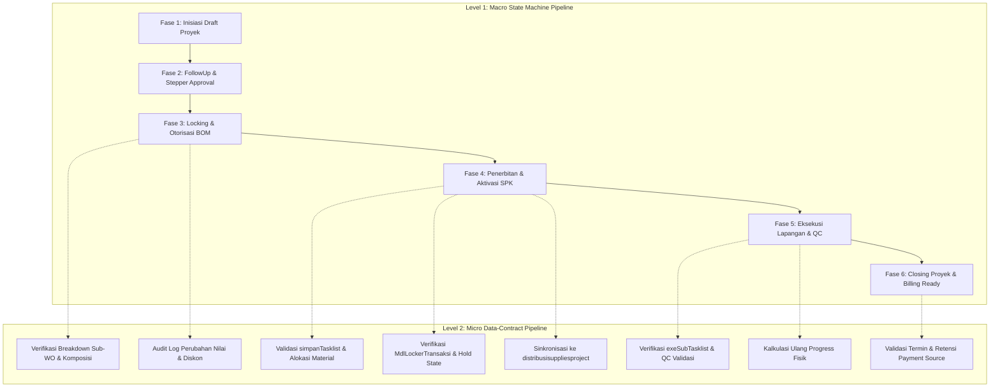

# Rencana Kerja UAT Mandiri: Hybrid 2-Level Pipeline (Modul Master Project)

Dokumen ini mendefinisikan rencana pengujian penerimaan pengguna (*User Acceptance Testing* - UAT) mandiri secara otomatis/semi-otomatis untuk memvalidasi alur bisnis dan integritas data pada modul `master_project`, dengan fokus utama pada [MasterData.php](file:///w:/everest_19okt/application/modules/master_project/controllers/MasterData.php) dan controller terkait.

---

## 1. Arsitektur Pipeline Pengujian

---

## 2. Rincian Tahapan Pelaksanaan

### Tahap 0: Persiapan Lingkungan UAT & Mekanisme Rollback
- **Tujuan:** Menjamin eksekusi pengujian tidak mencemari data produksi atau meninggalkan lock transaksi yang menggantung.
- **Langkah Kerja:**
  1. Membuat runner pengujian terisolasi (skrip CLI / endpoint controller pengujian khusus).
  2. Menyiapkan data acuan (*test fixtures*) dengan penanda khusus (prefix kode: `TEST-UAT-PRJ-*`).
  3. Membangun sesi kerja tiruan (`$_SESSION['login']` dengan role berwenang `o_project_spv` dan ID petugas uji).
  4. Menyediakan prosedur *teardown/cleanup* otomatis untuk menghapus baris transaksi uji dan melepaskan seluruh status `hold` di `MdlLockerTransaksi`.

---

### Tahap 1: Eksekusi Pipeline Level 1 (Makro Lifecycle)

#### Langkah 1.1: Inisiasi Proyek (Draft Creation)
- **Komponen Diuji:** [Create.php](file:///w:/everest_19okt/application/modules/master_project/controllers/Create.php), [_shoppingCart.php](file:///w:/everest_19okt/application/modules/master_project/controllers/_shoppingCart.php)
- **Validasi Kunci:**
  - Terbentuknya entitas di tabel `project_produk` dengan status draft (`status = '1'`, `lock = '0'`).
  - Tersimpannya elemen form default di `main_elements` sesi.

#### Langkah 1.2: Transisi Approval & Preservasi Sesi
- **Komponen Diuji:** [FollowUp.php](file:///w:/everest_19okt/application/modules/master_project/controllers/FollowUp.php)
- **Validasi Kunci:**
  - Validasi kepatuhan aturan konsistensi sesi: `main_elements` berhasil disalin dari sesi lama ke sesi baru.
  - State stepper pipeline bertransisi dari draft ke tahap verifikasi RAB/BOM.

#### Langkah 1.3: Penguncian & Otorisasi BOM
- **Komponen Diuji:** [MasterData.php](file:///w:/everest_19okt/application/modules/master_project/controllers/MasterData.php) (`saveBom()`, `authorizeBom()`, `project_reg_snapshoot()`)
- **Validasi Kunci:**
  - Registrasi request otorisasi BOM tercatat di registry.
  - Eksekusi `authorizeBom()` berhasil mengunci BOM (`lock = 1`) dan membuat snapshot data acuan.

#### Langkah 1.4: Penerbitan & Aktivasi SPK (Tasklist)
- **Komponen Diuji:** [MasterData.php](file:///w:/everest_19okt/application/modules/master_project/controllers/MasterData.php) (`taskList()`, `generatePreSPK()`, `exe_activate_task()`)
- **Validasi Kunci:**
  - Status tugas berubah menjadi aktif (`state = 'active'`).
  - Terbit nomor SPK resmi via fungsi `numbering()`.

#### Langkah 1.5: Eksekusi Pengerjaan & Verifikasi QC
- **Komponen Diuji:** [MasterData.php](file:///w:/everest_19okt/application/modules/master_project/controllers/MasterData.php) (`exeSubTasklist()`, `exeSubTasklistQc()`)
- **Validasi Kunci:**
  - Sub-pekerjaan berhasil ditandai selesai oleh pelaksana.
  - Verifikasi QC memvalidasi pekerjaan dan tidak ada catatan kegagalan yang memblokir.

#### Langkah 1.6: Finalisasi & Status Penagihan (Closing Proyek)
- **Komponen Diuji:** [MasterData.php](file:///w:/everest_19okt/application/modules/master_project/controllers/MasterData.php) (`recalculateProgressProject()`, `generatorPaymentSource()`)
- **Validasi Kunci:**
  - Progres fisik proyek mencapai 100%.
  - Sumber pembayaran termin dan retensi siap ditagih di modul kasir/piutang.

---

### Tahap 2: Eksekusi Pipeline Level 2 (Integritas Data Mikro & Kontrak Data)

#### Langkah 2.1: Validasi Pemecahan Sub-Work Order & Komposisi
- **Target:** Memvalidasi bahwa pemanggilan `rebuildMasterKomposisiSub()` menghasilkan baris data valid di `project_komposisi_workorder_sub` dengan kalkulasi proporsi kuantitas material dan jasa yang konsisten terhadap induknya.

#### Langkah 2.2: Validasi Atomic Transaction pada `simpanTasklist()`
- **Target:** Memvalidasi operasi multi-tabel dalam transaksi DB:
  - Pembentukan entri `tasklist`.
  - Pemecahan persentase material (`prepareArrMaterial`).
  - Pembaruan baris sinkronisasi (`saveProdukSync`, `saveBiayaDetailsSync`).
  - Verifikasi bahwa bila terjadi kegagalan data di salah satu tabel, mekanisme transaksi DB melakukan rollback penuh.

#### Langkah 2.3: Kontrol Concurrency & Locker Transaksi
- **Target:** 
  - Memvalidasi bahwa saat proses penerbitan SPK berjalan, baris pengunci di `MdlLockerTransaksi` berstatus `state = 'hold'`, `jumlah = '1'`.
  - Memverifikasi skenario *retake lock* jika petugas idle $\ge$ 5 menit.

#### Langkah 2.4: Sinkronisasi Lintas Modul (Logistik Material)
- **Target:** Memverifikasi kaitan data SPK ke modul `distribusisuppliesproject/Create`:
  - Ketersediaan stok material di gudang asal.
  - Alokasi stok melalui `ComLockerStockDualWrite` agar tidak terjadi *negative stock* atau *oversell*.

---

### Tahap 3: Pelaporan & Teardown Bersih
1. Mengumpulkan matriks hasil UAT (Pass/Fail, deviasi nilai kalkulasi, waktu respons query).
2. Mengeksekusi skrip pembersihan: menghapus seluruh data ber-prefix `TEST-UAT-PRJ-*`, menghapus entri locker transaksi, dan mengembalikan sesi ke keadaan awal.
3. Menyusun dokumen ringkasan hasil audit pengujian.

---

## 3. Evaluasi Teknis Kritis

### A. Trade-off & Risiko
- **Beban Database Transaksional:** Menjalankan alur lengkap sampai ke level distribusi stok memicu mutasi ledger dan dual-write stock locker. Jika tidak diisolasi dengan data dummy yang aman, stok fisik di cabang uji bisa terpengaruh.
- **Ketergantungan State Sesi:** Controller sangat terikat pada struktur array sesi global PHP. Pengujian otomatis yang berjalan di luar browser (misal lewat CLI) memerlukan mock sesi PHP manual yang presisi agar tidak terjadi *fatal error* akibat index array yang tidak terdefinisi.

### B. Alternatif Pendekatan
- **Pendekatan DB Transaction Rollback (`$this->db->trans_rollback()`):** Seluruh rangkaian UAT dibungkus dalam satu transaksi database global yang sengaja di-rollback di akhir pengujian.
  - *Kelemahan:* Tidak cocok untuk alur yang melibatkan HTTP redirect multi-langkah atau transaksi terdistribusi (MongoDB draft + MySQL).
- **Pendekatan Staging/Fixture Khusus (Direkomendasikan):** Menggunakan ID cabang dan gudang uji khusus (misal: Cabang Dummy) sehingga data riil aman tanpa bergantung pada rollback DB yang rentan terputus.

### C. Kritik Logika & Celah
- **Celah Sesi Mobile / Scanner:** `MasterData.php` memiliki beberapa alur penugasan yang dapat diakses oleh perangkat mobile/scanner (`followupDariHp`). Runner UAT berbasis CLI biasa berisiko melewatkan *session redirect loop* yang spesifik terjadi pada Safari iOS / WebKit jika tidak diuji dengan simulasi header HTTP yang sesuai.
